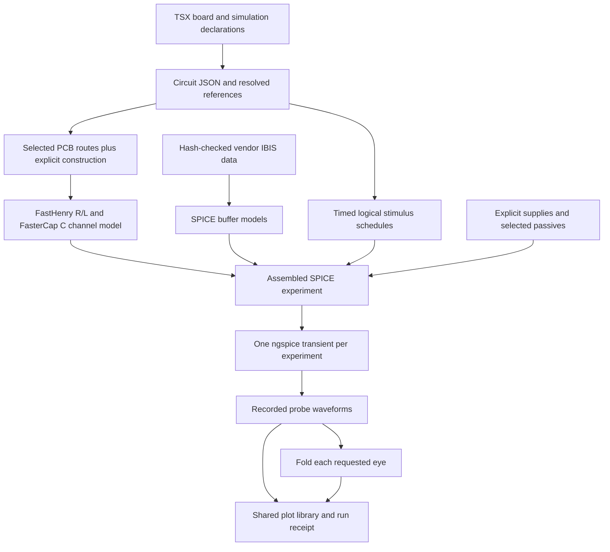

# IBIS Buffers, Digital Stimuli, and Eye Diagrams

**Status: Proposed.** Extend the existing analog simulation API with reusable
vendor IBIS definitions, per-experiment buffer states, binary traffic, and eyes
derived from voltage probes. The same syntax supports DDR, other differential
interfaces, and single-ended signals.

A runnable prototype is public in [0hmX/am3352-ddr-eye][implementation]. All
implementation links below pin commit `95c5990`; its [example PR][implementation-pr]
is merged in that repository. The tscircuit dependencies are experimental local
packages with [rebuildable source patches][patches], not upstream releases.

## Start here

1. Watch [one experiment, stimulus, waveform, and eye (76 seconds)][video-run]
   and [eye alignment versus observation time (73 seconds)][video-timing].
   [Transcripts and recording provenance][video-notes] are included.
2. Read the [complete DDR DQ0 example][ddr-dq]: one normal TSX entrypoint,
   real TI/Winbond model sources, routed pins, DQ traffic, and DQS strobe.
3. Compare [RS-485 differential data][rs485] and [single-ended CMOS data][cmos].
4. Follow the [source map](#implementation-source-map) to inspect conversion,
   PCB extraction, SPICE assembly, eye folding, plotting, and tests.

The videos explain the earlier 100 ns DQS-only experiment and replay recorded
solver waveforms. They use the prototype spelling `simulationRef`. The newer
DQ0 example additionally covers all eight three-bit histories. Neither video
is a hardware measurement or evidence of a new solver run.

## Why these declarations

A PCB route describes copper geometry. It does not describe a chip's nonlinear
output driver, input loading, supply connections, traffic, or measurement timing.
IBIS provides buffer electrical data, but it does not supply a complete board
stackup, choose an I/O operating mode, or generate a test pattern.

Keep those inputs explicit and reusable in a normal tscircuit project. Authors
write TSX and ordinary imported data; shared libraries perform conversion,
extraction, solving, and plotting. An example needs no custom simulation runner
or plot script. Generated waveforms, plots, and solver receipts belong in
ignored output directories.

| Declaration | Responsibility |
| --- | --- |
| `chip.ibisModel` / `<ibismodel>` | Vendor file, component, physical pin mapping, electrical model selection, rails, corner, package policy |
| `<analog.transientsimulation>` | One time-domain electrical experiment and its buffer operating states |
| `<analog.digitalstimulus>` | Logical bits controlling one output buffer in that experiment |
| `<voltageprobe>` | Voltage difference to record |
| `<analog.eyediagram>` | Fold that probe's recorded voltage using explicit timing |

The transient is the electrical simulation. A stimulus is an input to it; an
eye is analysis of its output. Multiple stimuli and eyes can share one run.

## Proposed syntax

### Reusable IBIS electrical data

Attach a model to a newly declared chip with
`ibisModel={<ibismodel {...definition} />}`. For a chip already present in an
imported routed board, use `<ibismodel componentRef=".U1" {...definition} />`.
Both forms use the same electrical definition and preserve existing routing.

For example, this definition uses the actual TI SN65HVD72 archive:

```tsx
const rs485Pads = {
  source: {
    url: "https://www.ti.com/lit/zip/sllm183",
    sha256: "935ce893dc388969a3e1319153daaa81e1486d786b87eed6a7d543b5f5dbfcba",
    archive: {
      member: "SN65HVD72_IBIS/sn65hvd72.ibs",
      memberSha256: "293f71f8d6c8764914a73564ebbb5b9e0e706d9dcc18d87aae91f1def06ca47e",
    },
  },
  component: "SN65HVD72D",
  pinMap: { "6": "A", "7": "B", "8": "VCC", "5": "GND" },
  modelSelections: { "6": "a_b_p", "7": "a_b_n" },
  references: {
    "6": { pullup: "VCC", pulldown: "GND", powerClamp: "VCC", groundClamp: "GND" },
    "7": { pullup: "VCC", pulldown: "GND", powerClamp: "VCC", groundClamp: "GND" },
  },
  corner: "typical",
  packagePolicy: "omit",
} satisfies IbisModelDefinition
```

`IbisModelDefinition` is exported by `@tscircuit/props`. The complete
[RS-485 board][rs485] shows its attachment, footprints, sources, and routing.

| Field | Contract |
| --- | --- |
| `source` | Exactly one of `{ url, sha256 }`, `{ file, sha256? }`, or `{ content, sha256? }`; URL/file sources may also specify `archive` |
| `source.sha256` | Hash of original resource bytes, before extraction; for inline content, hash UTF-8 bytes |
| `source.archive` | Exact ZIP `member`, with optional `memberSha256` for extracted bytes; examples pin both hashes |
| `component` | Exact component name inside the IBIS file |
| `pinMap` | Physical IBIS pin → local TSX port label, including reference/supply pins |
| `modelSelections` | Optional physical signal pin → model allowed by its vendor model selector; required when selection is ambiguous |
| `references` | Optional physical signal pin → local TSX ports for output and clamp references; infer only when unambiguous |
| `corner` | Required `"typical"`, `"minimum"`, or `"maximum"`; selects vendor typ/min/max data |
| `packagePolicy` | Required `"vendor"` or `"omit"`; unsupported vendor package representations must fail |

File paths resolve relative to the TSX entrypoint directory, including model
definitions imported from another module. Downloaded bytes must match their
hash before use; cached downloads undergo the same check. A URL is a source of
data, not an instruction to guess a model from a part number. IBIS files commonly
use `.ibs`; a filename extension alone does not establish supported contents.

`pullup` is the driver's high-side reference and `pulldown` its low-side
reference. `powerClamp` and `groundClamp` reference the corresponding protection
I/V tables when present. These are chip port names, not external pullup or
pulldown resistors. The tables and mappings depend on the vendor model; four
explicit overrides are not universally required. Ambiguous supply banks require
explicit mappings. An unsupported external reference control must fail.

`packagePolicy` is our import policy, not an IBIS keyword. `"omit"` excludes
package parasitics while retaining buffer tables and die capacitance; it must be
recorded as an approximation. `"vendor"` retains supported package data and
rejects unsupported cases rather than silently omitting them.

### One transient, multiple stimuli and measurements

This is an excerpt of the [runnable DDR DQ0 board][ddr-dq] using the **proposed
final spelling** `transientSimulationRef`. **The prototype currently requires
`simulationRef` instead.** Run the linked file unchanged; the rename and removal
of redundant explicit `spiceEngine="ngspice"` from examples remain migration work.
This RFC does not remove the shared analog API's existing engine props.

```tsx
<analog.transientsimulation
  name="DDR_SI"
  duration="160ns"
  timePerStep="10ps"
  ibisPinStates={{
    ".U1 > .M3": { mode: "output", enabled: true },
    ".U1 > .P1": { mode: "output", enabled: true },
    ".U1 > .P2": { mode: "output", enabled: true },
    ".U3 > .E3": { mode: "input" },
    ".U3 > .F3": { mode: "input" },
    ".U3 > .G3": { mode: "input" },
  }}
/>
<analog.digitalstimulus
  name="DQ0" transientSimulationRef=".DDR_SI" drives=".U1 > .M3"
  unitInterval="2.5ns" startTime="0ns" initialState={0}
  pattern={{ type: "bits", bits: "00010111", repeat: true }}
/>
<analog.digitalstimulus
  name="DQS_P" transientSimulationRef=".DDR_SI" drives=".U1 > .P1"
  unitInterval="2.5ns" startTime="1.25ns" initialState={0}
  pattern={{ type: "bits", bits: "01", repeat: true }}
/>
<analog.digitalstimulus
  name="DQS_N" transientSimulationRef=".DDR_SI" drives=".U1 > .P2"
  unitInterval="2.5ns" startTime="1.25ns" initialState={0} inverted
  pattern={{ type: "bits", bits: "01", repeat: true }}
/>
<voltageprobe name="DQ0_RX" connectsTo=".U3 > .E3" referenceTo=".U3 > .B1" />
<voltageprobe name="DQS_RX" connectsTo=".U3 > .F3" referenceTo=".U3 > .G3" />
<analog.eyediagram
  name="DQ0_receive_eye" transientSimulationRef=".DDR_SI" probeRef=".DQ0_RX"
  unitInterval="2.5ns" timeOrigin="0ns" startTime="40ns"
/>
<analog.eyediagram
  name="DQS_receive_eye" transientSimulationRef=".DDR_SI" probeRef=".DQS_RX"
  unitInterval="2.5ns" timeOrigin="1.25ns" startTime="40ns"
/>
```

The omitted surrounding TSX attaches TI `am335x_zcz` and Winbond
`W631GG6MB-12` definitions, the saved routed board, explicit 1.5 V source, and
the exported construction/extraction inputs. DQ0 is U1.M3 → U3.E3; DQS is
U1.P1/P2 → U3.F3/G3. Selected TI models are `Model_343`, `Model_655`, and
`Model_847`; Winbond uses `ODT_60`. [Sources, hashes, rails, and mappings][ddr-models]
are part of the example, not inferred by an LLM.

`00010111` repeated cyclically contains all eight consecutive three-bit
histories: `000`, `001`, `010`, `011`, `100`, `101`, `110`, and `111`.
It is one serial data signal, not a three-bit bus. DQS remains an alternating
strobe with a nominal half-UI offset. This is a write-direction pad/channel
experiment, not a functional memory transaction.

### Experiment and stimulus rules

`ibisPinStates` maps scoped signal-pin selectors to `{ mode: "input" }` or
`{ mode: "output", enabled: boolean }`. States apply for the whole experiment;
dynamic turnaround is outside this proposal. Every selected modeled signal
requires an explicit compatible state in the initial API. Inferring fixed
input/output models can be a later convenience; bidirectional behavior cannot
be chosen from the file alone. Disabling an output requires a model that
supports it.

`transientSimulationRef` is required on stimuli and eyes and must select exactly
one transient experiment in the same scope. `drives` independently selects one
IBIS output pin. Missing, ambiguous, wrong-analysis, cross-scope, conflicting
stimulus, or incompatible pin-state declarations must fail before solving.

A stimulus requires `name`, `drives`, `transientSimulationRef`, positive
`unitInterval`, nonnegative `startTime`, `initialState: 0 | 1`, and `pattern`.
The only initial pattern variant is
`{ type: "bits", bits: string, repeat: boolean }`, with a nonempty binary string.
There is no implicit PRBS or protocol generator. A nonrepeating pattern must
cover the requested run. `initialState` applies before the pattern begins;
`inverted` complements that state and the bits once. Vendor polarity is applied
separately. Bits control the IBIS buffer; they do not force an ideal voltage
onto the copper.

For binary NRZ, `unitInterval="2.5ns"` means 400 Mbit/s. A repeated `01` pattern
has a 5 ns period, or 200 MHz. The eye's UI describes its folding reference;
it does not generate traffic. Different source and observation UIs are explicit
choices, not automatically synchronized clocks.

### Probes and eye timing

The existing voltage probe measures `V(connectsTo) - V(referenceTo)`.
Reference a ground port for a single-ended voltage or the other signal port
for a differential voltage. No DDR-specific positive/negative eye props are
needed. An eye requires `name`, `transientSimulationRef`, `probeRef`, positive
`unitInterval`, and finite `timeOrigin`; `startTime` and `endTime` are optional
observation limits, defaulting to the recorded waveform bounds.

Use unit-bearing strings. Bare numeric times use milliseconds, matching the
existing analog API and Circuit JSON. `duration` is the experiment's end time;
`timePerStep` bounds solver integration steps. Output samples can have adaptive
timestamps; plot interpolation is a separate operation.

`timeOrigin` anchors the folding grid, `b_k = timeOrigin + k * UI`. Eye
`startTime`/`endTime` choose recorded data to include; changing them does not
rerun the circuit or move that grid. The prototype takes complete two-UI windows
`[b_k - UI/2, b_k + 3*UI/2]` inside the observation gate and interpolates actual
solver samples. A gate that leaves no complete windows fails. This proposal
specifies fixed timing; it does not imply recovered-clock or PLL analysis.

## What happens under the hood



1. Normal rendering registers data and resolves selectors. It does not launch
   native solvers. Simulation is an explicit CLI/library action.
2. Routed copper supplies lengths, widths, layers, and connectivity. Construction
   and extraction inputs additionally supply dielectric properties, conductor
   thickness/conductivity, return assumptions, spacing, and discretization.
   The prototype reads these from an exported `modeling` object; their full
   upstream board/recipe schema is not standardized by this RFC.
3. FastHenry supplies resistance/inductance matrices and FasterCap capacitance.
   The runner forms a coupled, segmented SPICE channel. These matrices describe
   the reduced geometry actually sent to the solvers, not automatically the
   whole PCB.
4. IBIS I/V, clamp, capacitance, and switching data become buffer subcircuits.
   Logical schedules control their transitions. The runner connects them to
   the extracted channel, explicit rails, and selected passives, then runs
   ngspice once for each declared transient experiment.
5. All probes read that run. Shared postprocessing folds each eye and generates
   waveform and eye CSV/PNG/SVG files. No per-example Python file is needed.

IBIS is electrical interface data, not a proprietary simulator executable or
the chip's internal RTL. The converter uses the supplied tables and supported
features; it does not simulate CPU instructions or memory commands. Unsupported
features must produce diagnostics, not invented replacements.

## Circuit JSON and execution boundary

Extend the existing analog experiment/result vocabulary rather than encoding
electrical intent only in an opaque runner script:

| TSX | Circuit JSON relationship |
| --- | --- |
| `<ibismodel>` / `chip.ibisModel` | `simulation_ibis_model` bound to `source_component_id`, mapped source-port IDs, source and policy data |
| `ibisPinStates` | `simulation_ibis_pin_state` bound to experiment and source port |
| `<analog.digitalstimulus>` | `simulation_digital_stimulus` bound to experiment and driven source port |
| `<voltageprobe>` | Existing `simulation_voltage_probe` with signal/reference IDs |
| `<analog.eyediagram>` | `simulation_eye_diagram` bound to experiment and voltage probe |
| Transient output | Existing `simulation_transient_voltage_graph`, retaining experiment and probe IDs and actual timestamps |

Normalize time fields to milliseconds; resolve selectors to stable IDs before
execution. Eye declarations describe derived analysis, not a second
`simulation_experiment`. The prototype stores detailed eye samples/metadata in
run sidecars; a first-class serialized eye-result schema remains a review item.
The [schema patch][circuit-json] contains exact implemented record shapes.

Keep backend installation, execution, and receipts in shared tooling. Only
ngspice is implemented for this IBIS path today. Do not suggest other engines
work by listing them in examples. Receipts retain actual solver versions/hashes,
model bytes/hashes, resolved pins/states/rails, construction assumptions,
extracted matrices, executed commands, and plotting inputs. Downloads/tools may
be cached; a requested fresh repetition must rerun the solvers.

## Try the exact prototype locally

Prerequisites: Node.js 22+, pnpm 11.25.0, Bun for the pinned tsci launcher/tests,
Python 3.11, Git, and a C/C++ compiler. Native setup is documented in the
[project README][readme] and [toolchain lock][tools], including upstream tool
licenses. It builds pinned solver sources and plotting dependencies; setup
uses Homebrew on macOS or apt on Linux. Execution was verified on macOS arm64.

```sh
git clone https://github.com/0hmX/am3352-ddr-eye.git
cd am3352-ddr-eye
git checkout 95c59905435ed2abe9b3ef89b98f7a8504dc3294
pnpm install --frozen-lockfile
pnpm typecheck
pnpm simulate:setup
pnpm simulate:ddr-dq --repeat --out dist/rfc-ddr-dq
pnpm simulate:non-ddr
pnpm simulate:single-ended
pnpm test:native
```

Use a fresh output directory on subsequent runs. The repeated DDR command
writes `run-a/`, `run-b/`, and `repeatability.json`. Inside each run,
`experiments/<id>/waveform.png` shows all declared probes and
`experiments/<id>/eyes/<id>/eye.png` shows the corresponding eye; CSV/SVG and
`receipt.json` retain the underlying data and provenance. Outputs stay under
ignored `dist/`. `pnpm dev` opens the normal tscircuit board preview; it does
not itself run the native simulation or display a built-in eye viewer.

The [native integration test][native-tests] runs DDR DQ0, RS-485, and CMOS with
real vendor models and checks one actual ngspice invocation per experiment,
probe-bound waveforms, and shared-library plot generation. For DDR it samples
received DQ0 at actual received DQS crossings and checks all eight three-bit
histories in both the received data and eye windows. The recorded run produced
48 received bits and 46 DQ eye windows. This finite coverage is not exhaustive
long-history coverage or a BER prediction.

## Modeling limits and scope

The AM3352 source is a published saved routing checkpoint. Its selected DQ/DQS
routes exist, but the original board has incomplete routing and failed strict
DDR length checks. **“Pre-solved” means saved routing, not independently
validated electrical behavior.** [Board provenance][provenance] preserves that
assessment and the original source/version.

The current backend supports one to three selected channels with matching
ordered stage topology, using straightened routed lengths/widths, assumed
spacing, and a finite return strip. The DDR DQ example assumes uniform 0.75 mm
signal center spacing, effective dielectric constants, and fixed-frequency R/L.
It includes selected-channel mutual coupling and shared return effects, but
omits full planes, surrounding aggressors, detailed via pads/stubs, dielectric
loss, copper roughness, the PDN, and package parasitics (`packagePolicy="omit"`).

Rails and stimulus timing are ideal. No random noise/jitter, DDR commands,
training, burst behavior, automatic clock recovery, eye-mask/JEDEC compliance,
or hardware correlation is claimed. The converter holds endpoint current
outside characterized I/V table bounds and records that approximation. The
unterminated CMOS fixture rings above its 3.3 V rail, to about 5.63 V, with a
selected input model lacking a power-clamp table; it demonstrates workflow
generality, not a safe interface. Repeated numerical output does not establish
physical accuracy.

## Compatibility and review questions

This extends [SPICE Simulation Analyses, Stimulus, and Measurements](2026-07-20-analog-simulation-analyses-and-parameter-sweeps.md).
It reuses its transient experiment, units, sources, probes, and voltage graph.
Existing analog circuits need no IBIS declarations. Existing source-waveform
support remains appropriate for direct voltage/current excitation.

The separate [PCB channel experiments and recipes proposal](https://github.com/tscircuit/rfc/pull/23)
addresses planning and repeated S-parameter extraction. This proposal addresses
IBIS buffer excitation and time-domain observations. A channel recipe could
supply an extracted channel; neither API implies its backend has been
numerically qualified or makes the other proposal's runner mandatory.

Before upstream implementation, review:

- Confirm `transientSimulationRef` as the public spelling; migrate the prototype
  schemas, binding logic, examples, docs, and tests together. Keep serialized
  `simulation_experiment_id`; do not accept conflicting old/new props.
- Decide whether to infer unambiguous fixed pin directions. The initial explicit
  state form remains available for all models; bidirectional direction/enable
  remains experiment intent.
- Agree where selected-channel construction and extraction recipes live. Do not
  hide missing geometry/material assumptions behind the eye element.
- Specify an eye-result schema and viewer separately from this declaration API.
  PRBS, dynamic enable/turnaround, clock recovery, statistical eyes, other IBIS
  model families, and additional solvers require further contracts and tests.

## Implementation source map

All links use the same pinned implementation commit. Review the source and
tests rather than relying on committed simulation pictures.

| Inspect | Exact source |
| --- | --- |
| Runnable DDR DQ0 + DQS entrypoint | [examples/ddr-dq/index.circuit.tsx][ddr-dq] |
| TI/Winbond electrical definitions and sources | [simulation.config.ts][ddr-models], [vendor-models.json][ddr-vendors] |
| Non-DDR differential / single-ended entrypoints | [RS-485][rs485], [CMOS][cmos], [vendor source lock][other-vendors] |
| Board construction and source assessment | [board-construction.json][construction], [source-provenance.json][provenance] |
| Public prop schemas / core binding / Circuit JSON | [props.patch][props], [core.patch][core], [circuit-json.patch][circuit-json], [base commits and rebuild manifest][patches] |
| IBIS parsing and conversion | [parse-ibis.ts][parse], [general.ts][converter], [convert.ts][buffer-converter] |
| TSX loading and selector-bound run planning | [pipeline.mjs][pipeline], [declarations.mjs][declarations] |
| Routed geometry and native extraction | [geometry.mjs][geometry], [extraction.mjs][extraction] |
| SPICE assembly and one-run orchestration | [general-spice.mjs][assembly], [general-pipeline.mjs][runner] |
| Eye folding / automatic shared plotting | [metrics.mjs][metrics], [scripts/plot.py][plotter] |
| Native vendor/coverage proof / fresh repetition | [general.integration.mjs][native-tests], [repeat.mjs][repeat], [converter tests][converter-tests] |

[implementation]: https://github.com/0hmX/am3352-ddr-eye/tree/95c59905435ed2abe9b3ef89b98f7a8504dc3294
[implementation-pr]: https://github.com/0hmX/am3352-ddr-eye/pull/1
[readme]: https://github.com/0hmX/am3352-ddr-eye/blob/95c59905435ed2abe9b3ef89b98f7a8504dc3294/README.md
[ddr-dq]: https://github.com/0hmX/am3352-ddr-eye/blob/95c59905435ed2abe9b3ef89b98f7a8504dc3294/examples/ddr-dq/index.circuit.tsx
[rs485]: https://github.com/0hmX/am3352-ddr-eye/blob/95c59905435ed2abe9b3ef89b98f7a8504dc3294/examples/differential-data/index.circuit.tsx
[cmos]: https://github.com/0hmX/am3352-ddr-eye/blob/95c59905435ed2abe9b3ef89b98f7a8504dc3294/examples/single-ended/index.circuit.tsx
[ddr-models]: https://github.com/0hmX/am3352-ddr-eye/blob/95c59905435ed2abe9b3ef89b98f7a8504dc3294/simulation.config.ts
[ddr-vendors]: https://github.com/0hmX/am3352-ddr-eye/blob/95c59905435ed2abe9b3ef89b98f7a8504dc3294/vendor-models.json
[other-vendors]: https://github.com/0hmX/am3352-ddr-eye/blob/95c59905435ed2abe9b3ef89b98f7a8504dc3294/examples/vendor-models.lock.json
[construction]: https://github.com/0hmX/am3352-ddr-eye/blob/95c59905435ed2abe9b3ef89b98f7a8504dc3294/board-construction.json
[provenance]: https://github.com/0hmX/am3352-ddr-eye/blob/95c59905435ed2abe9b3ef89b98f7a8504dc3294/source-provenance.json
[patches]: https://github.com/0hmX/am3352-ddr-eye/blob/95c59905435ed2abe9b3ef89b98f7a8504dc3294/.packages/native-patches/manifest.json
[props]: https://github.com/0hmX/am3352-ddr-eye/blob/95c59905435ed2abe9b3ef89b98f7a8504dc3294/.packages/native-patches/props.patch#L691
[core]: https://github.com/0hmX/am3352-ddr-eye/blob/95c59905435ed2abe9b3ef89b98f7a8504dc3294/.packages/native-patches/core.patch
[circuit-json]: https://github.com/0hmX/am3352-ddr-eye/blob/95c59905435ed2abe9b3ef89b98f7a8504dc3294/.packages/native-patches/circuit-json.patch#L1243
[parse]: https://github.com/0hmX/am3352-ddr-eye/blob/95c59905435ed2abe9b3ef89b98f7a8504dc3294/packages/ibis-to-spice/lib/parse-ibis.ts
[converter]: https://github.com/0hmX/am3352-ddr-eye/blob/95c59905435ed2abe9b3ef89b98f7a8504dc3294/packages/ibis-to-spice/lib/general.ts#L123
[buffer-converter]: https://github.com/0hmX/am3352-ddr-eye/blob/95c59905435ed2abe9b3ef89b98f7a8504dc3294/packages/ibis-to-spice/lib/convert.ts#L186
[pipeline]: https://github.com/0hmX/am3352-ddr-eye/blob/95c59905435ed2abe9b3ef89b98f7a8504dc3294/packages/pcb-spice-pipeline/src/pipeline.mjs#L27
[declarations]: https://github.com/0hmX/am3352-ddr-eye/blob/95c59905435ed2abe9b3ef89b98f7a8504dc3294/packages/pcb-spice-pipeline/src/declarations.mjs#L35
[geometry]: https://github.com/0hmX/am3352-ddr-eye/blob/95c59905435ed2abe9b3ef89b98f7a8504dc3294/packages/pcb-spice-pipeline/src/geometry.mjs
[extraction]: https://github.com/0hmX/am3352-ddr-eye/blob/95c59905435ed2abe9b3ef89b98f7a8504dc3294/packages/pcb-spice-pipeline/src/extraction.mjs#L6
[assembly]: https://github.com/0hmX/am3352-ddr-eye/blob/95c59905435ed2abe9b3ef89b98f7a8504dc3294/packages/pcb-spice-pipeline/src/general-spice.mjs#L63
[runner]: https://github.com/0hmX/am3352-ddr-eye/blob/95c59905435ed2abe9b3ef89b98f7a8504dc3294/packages/pcb-spice-pipeline/src/general-pipeline.mjs
[metrics]: https://github.com/0hmX/am3352-ddr-eye/blob/95c59905435ed2abe9b3ef89b98f7a8504dc3294/packages/pcb-spice-pipeline/src/metrics.mjs#L67
[plotter]: https://github.com/0hmX/am3352-ddr-eye/blob/95c59905435ed2abe9b3ef89b98f7a8504dc3294/packages/pcb-spice-pipeline/scripts/plot.py
[native-tests]: https://github.com/0hmX/am3352-ddr-eye/blob/95c59905435ed2abe9b3ef89b98f7a8504dc3294/packages/pcb-spice-pipeline/tests/general.integration.mjs#L54
[repeat]: https://github.com/0hmX/am3352-ddr-eye/blob/95c59905435ed2abe9b3ef89b98f7a8504dc3294/packages/pcb-spice-pipeline/src/repeat.mjs
[converter-tests]: https://github.com/0hmX/am3352-ddr-eye/tree/95c59905435ed2abe9b3ef89b98f7a8504dc3294/packages/ibis-to-spice/tests
[tools]: https://github.com/0hmX/am3352-ddr-eye/blob/95c59905435ed2abe9b3ef89b98f7a8504dc3294/packages/pcb-spice-pipeline/toolchain-lock.json
[video-run]: ../assets/2026-10-16-ibis-eye-diagrams/one-simulation-explained.mp4?raw=true
[video-timing]: ../assets/2026-10-16-ibis-eye-diagrams/time-origin-vs-start-time.mp4?raw=true
[video-notes]: ../assets/2026-10-16-ibis-eye-diagrams/README.md
